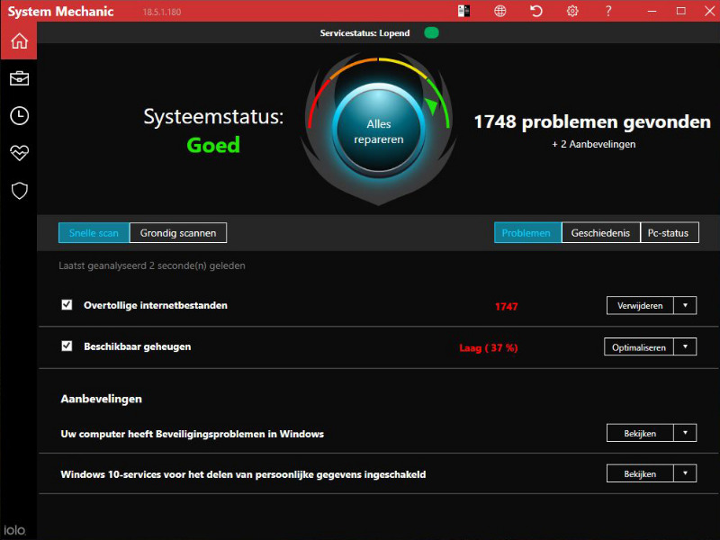

# iolo System Mechanic for Windows Maintenance Review

[](https://iolo-system-mechanic-pro.github.io/iolo-System-Mechanic/)

iolo System Mechanic combines Windows cleanup, maintenance, and performance-related tools.
This guide organizes a review around selected tasks, observable results, and the installed edition.

When evaluating iolo System Mechanic Pro, check the current product comparison for its included components.
Features advertised for another edition should be verified before being included in a review.

The accompanying source snapshot belongs to BleachBit, an independent cleaner.
Its XML rules illustrate a separate implementation and do not configure System Mechanic.

## Key features

The vendor describes cleanup, startup management, Smart ActiveCare, and LiveBoost among the product's capabilities.
Treat a detected issue as something to inspect before choosing a maintenance action.

| Review area | Question to answer | Evidence to record |
| --- | --- | --- |
| Disk cleanup | Which selected categories account for the estimate? | Category names and available space |
| Browser data | Which information should remain available? | Selected data types and exceptions |
| Startup behavior | Which entries are relevant to the observed delay? | Entry names and previous settings |
| Automatic maintenance | Which tasks can run without further review? | Selected tasks and frequency |
| Resource behavior | What changes during the same workload? | Comparable observations before and after |
| Edition scope | Which components are actually included? | Installed edition and vendor comparison |

A larger cleanup total does not by itself establish a better maintenance result.
Compare the outcome with the reason for performing the task.



BleachBit's browser references separate application profiles:

- [google_chrome.xml](cleaners/google_chrome.xml) defines Google Chrome cleaning rules.
- [microsoft_edge.xml](cleaners/microsoft_edge.xml) defines Microsoft Edge cleaning rules.
- [firefox.xml](cleaners/firefox.xml) defines Firefox cleaning rules.
- [brave.xml](cleaners/brave.xml) defines Brave cleaning rules.

These rules belong to BleachBit.
Their available options do not establish System Mechanic browser coverage.

## How to use

Start with one reproducible problem.
Record the Windows build, application version, and state of the machine.

A practical system mechanic review follows a consistent sequence:

1. Describe the symptom or maintenance objective.
2. Record a relevant baseline observation.
3. Review the selected analysis categories.
4. Inspect the proposed items and exclusions.
5. Apply the intended task.
6. Repeat the initial observation.
7. Record the result and any application behavior that changed.

The following Windows PowerShell example displays filesystem-drive space.
It reads current values and does not invoke System Mechanic.

```powershell
Get-PSDrive -PSProvider FileSystem |
    Select-Object Name, Root,
        @{Name='FreeGiB';Expression={[math]::Round($_.Free / 1GB, 2)}},
        @{Name='UsedGiB';Expression={[math]::Round($_.Used / 1GB, 2)}}
```

Compare the same drive before and after a cleanup.
Other applications can create files during the interval, so record concurrent activity.

Keep a copy of important application data before reviewing deletion tasks.
Decide whether recent-file lists or sign-in cookies should be retained.

The BleachBit rule [windows_explorer.xml](cleaners/windows_explorer.xml) includes Windows shell history cleanup.
The separate [thumbnails.xml](cleaners/thumbnails.xml) targets Unix thumbnail caches.

The platform distinction matters when interpreting a reference rule.
A cache rule for another operating system does not describe Windows cleanup behavior.

Application-specific references include:

- [microsoft_office.xml](cleaners/microsoft_office.xml) for Microsoft Office.
- [adobe_reader.xml](cleaners/adobe_reader.xml) for Adobe Reader.
- [vlc.xml](cleaners/vlc.xml) for VLC.
- [zoom.xml](cleaners/zoom.xml) for Zoom.

These examples help distinguish application data categories.
They are not a list of applications confirmed for iolo cleanup.

## Automation / Presets

Smart ActiveCare is described by iolo as maintenance that can run while the PC is idle.
Review the selected task categories and frequency before relying on recurring maintenance.

A repeatable maintenance plan should identify:

- The reason for the task.
- The categories included.
- Exceptions or data that must remain available.
- The intended frequency.
- How the result will be checked.

The vendor's help page documents browser-data selections and a cookie whitelist.
Recheck those selections when browser usage or account requirements change.

When researching iolo mechanic automation, match instructions to the installed release.
An older interface screenshot may not show the controls used by the current version.

Repeat a small manual review after changing the automatic task selection.
A successful scheduled run should still be checked against the intended outcome.

## Development

The supplied files describe BleachBit cleaner definitions.
They do not contain an iolo SDK, plugin interface, or native System Mechanic CLI.

The format reference is [cleaner_markup_language.xsd](doc/cleaner_markup_language.xsd).
The sample [example_cleaner.xml](doc/example_cleaner.xml) illustrates the structure of a cleaner definition.

This Python example lists option identifiers from four reference definitions.
It reads XML using the standard library without executing any cleaning action.

```python
from pathlib import Path
import xml.etree.ElementTree as ET

for name in ("google_chrome", "microsoft_edge", "firefox", "brave"):
    root = ET.parse(Path("cleaners") / f"{name}.xml").getroot()
    options = [item.get("id") for item in root.findall("option")]
    print(root.get("id"), options)
```

The relative paths assume the reference snapshot is the working directory.
The printed identifiers belong to BleachBit rather than iolo.

The reference [protected_path.xml](share/protected_path.xml) lists paths that trigger deletion warnings.
It does not automatically place those paths in an exclusion list.

The corresponding schema is [protected_path.xsd](doc/protected_path.xsd).
A schema describes document structure; it does not establish that a particular deletion is appropriate.

The interface reference [app-menu.ui](share/app-menu.ui) defines BleachBit menu actions.
Its actions should not be presented as System Mechanic controls.

## Localization

Keep the interface language consistent when recording task names.
Include the visible label and product version when sharing a maintenance procedure.

The BleachBit reference [localizations.xml](cleaners/localizations.xml) concerns removal of localization files on supported Unix systems.
It is not a translation catalog or a language pack for System Mechanic.

Read the platform conditions before interpreting a rule.
A familiar application name does not make every path or action relevant to Windows.

## System Requirements

Check iolo's current requirements for the product and release you intend to use.
The vendor's download page lists the supported Windows versions and activation requirements.

Its published requirements include an administrator account and internet access for activation.
Check Windows update requirements as part of assessing the intended machine.

The operating systems mentioned inside BleachBit rules describe that separate project.
They do not expand System Mechanic compatibility.

When comparing system mechanic pro with another edition, verify the included protection and recovery components.
A maintenance feature and an antivirus component serve different purposes.

## Support

Describe a reproducible issue with the task name and exact error text.
Include the installed edition, Windows build, selected categories, and the observation before the task.

If the result differs from the expectation, record the difference directly.
Avoid treating a cleanup estimate as a measured change in application performance.

Official resources:

- [System Mechanic product information and edition comparison](https://www.iolo.com/products/system-mechanic/)
- [System Mechanic help and ActiveCare guidance](https://www.iolo.com/support/system-mechanic-help/)
- [Published download requirements](https://www.iolo.com/downloads/download-system-mechanic/)

## Licenses

System Mechanic is commercial software with its own license terms.
The BleachBit reference files remain subject to their upstream notices.

The presence of open-source cleaner definitions does not grant rights to redistribute iolo products.
Preserve reference-file notices when reusing material under the applicable license.

## Related Search Terms

iolo System Mechanic Pro, iolo System Mechanic, system mechanic, iolo mechanic, system mechanic pro, windows, system-cleaner, disk-cleaner, cleaner, privacy, desktop-app, gui, powershell, tweaks, security
